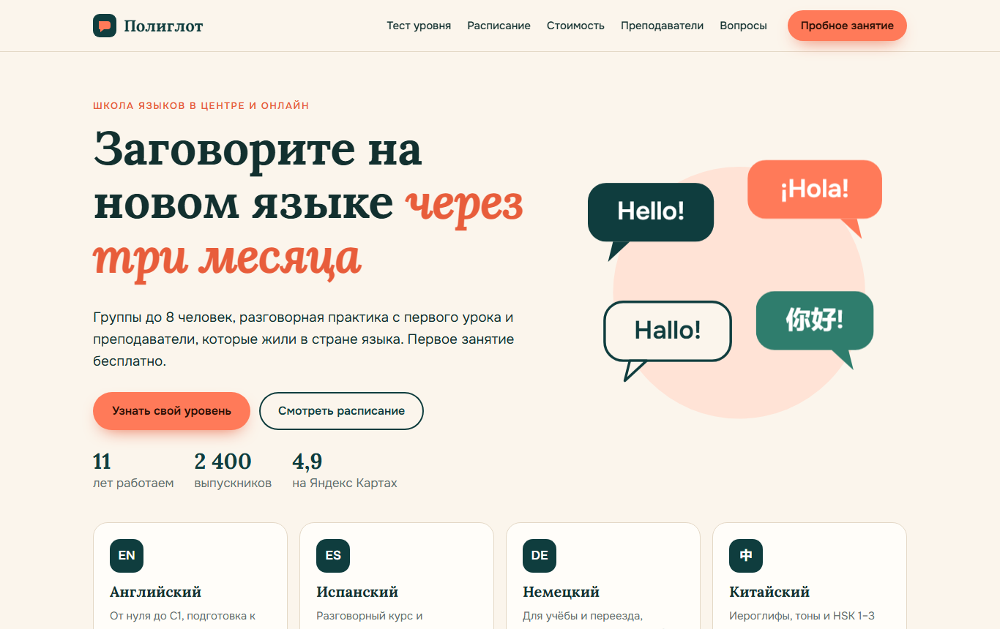

# Полиглот: сайт школы иностранных языков

Сайт языковой школы, на котором можно не только почитать о курсах, но и сразу определить свой уровень, найти подходящую группу и посчитать стоимость обучения. Без фреймворков: HTML, CSS и модульный JavaScript.


**Демо:** [whysafe.github.io/poliglot](https://whysafe.github.io/poliglot/)



## Возможности

**Тест уровня английского**
- 10 вопросов от простых к сложным, у сложных вопросов больший вес.
- Можно вернуться назад или пропустить вопрос.
- Результат от A1 до C1 с пояснением. Кнопка «Подобрать группу» сразу фильтрует расписание по этому уровню, а уровень подставляется в заявку.

**Расписание групп**
- Фильтры по языку, уровню, формату (в классе или онлайн) и наличию свободных мест.
- Карточки с днями, временем, преподавателем и числом мест. «Осталось 1 место» подсвечивается.
- Кнопка «Записаться» заполняет форму заявки языком и уровнем группы.

**Калькулятор стоимости**
- Группа, пара или индивидуально, от 1 до 5 занятий в неделю.
- Онлайн на 10% дешевле, абонемент на 3 месяца с дополнительной скидкой 7%, на 6 месяцев 12%.
- Показывает цену за занятие, за месяц, за весь абонемент и сколько удалось сэкономить.

**Заявка**
- Проверка имени, телефона, языка и согласия, все ошибки показываются сразу, фокус переходит на первое неверное поле.
- Телефон принимается в любом виде (`8 (916) 123-45-67`, `+7 916…`, `916…`) и приводится к `+7`.
- Это демо, поэтому заявка сохраняется в `localStorage` браузера, а не уходит на сервер.

**Оформление**
- Палитра: тёмно-бирюзовый, коралловый и кремовый. Шрифты Lora для заголовков и Onest для текста.
- Иллюстрация на первом экране нарисована в SVG, облачка «Hello / ¡Hola! / Hallo / 你好» плавно покачиваются. При настройке «уменьшить движение» анимация отключается.
- Адаптив от 360 px: бургер-меню, одна колонка карточек, поля фильтров во всю ширину.
- Доступность: видимый фокус, `aria-live` у расписания, `aria-invalid` у полей с ошибкой, `<details>` для вопросов.

## Запуск

Сборка не нужна. Из-за ES-модулей страницу нужно открывать через сервер, а не как файл:

```bash
python -m http.server 8000     # затем http://localhost:8000
```

## Как устроено

```
index.html       разметка всех секций
css/styles.css   стили и адаптив
js/logic.js      чистая логика: тест, фильтры, цены, телефон, проверка заявки
js/app.js        работа со страницей
test/            node:test для logic.js
```

Вся логика, которую можно проверить без браузера, вынесена в `logic.js`: расчёт уровня, фильтрация групп, формула цены, нормализация телефона и валидация. Её же импортируют тесты.

## Тесты

```bash
npm test
```

9 тестов: границы уровней теста, корректность ответов в вопросах, комбинации фильтров, расчёт цены со скидками и ограничением числа занятий, нормализация телефонов и проверка заявки. Тесты запускаются в GitHub Actions на каждый push.

## Автор

whysafe · [whysafe.ru](https://whysafe.ru) · Telegram [@yawhysafe](https://t.me/yawhysafe) · канал [@whysafe_official](https://t.me/whysafe_official) · [Kwork](https://kwork.ru/user/whysafe) · hello@whysafe.ru

## Лицензия

MIT
